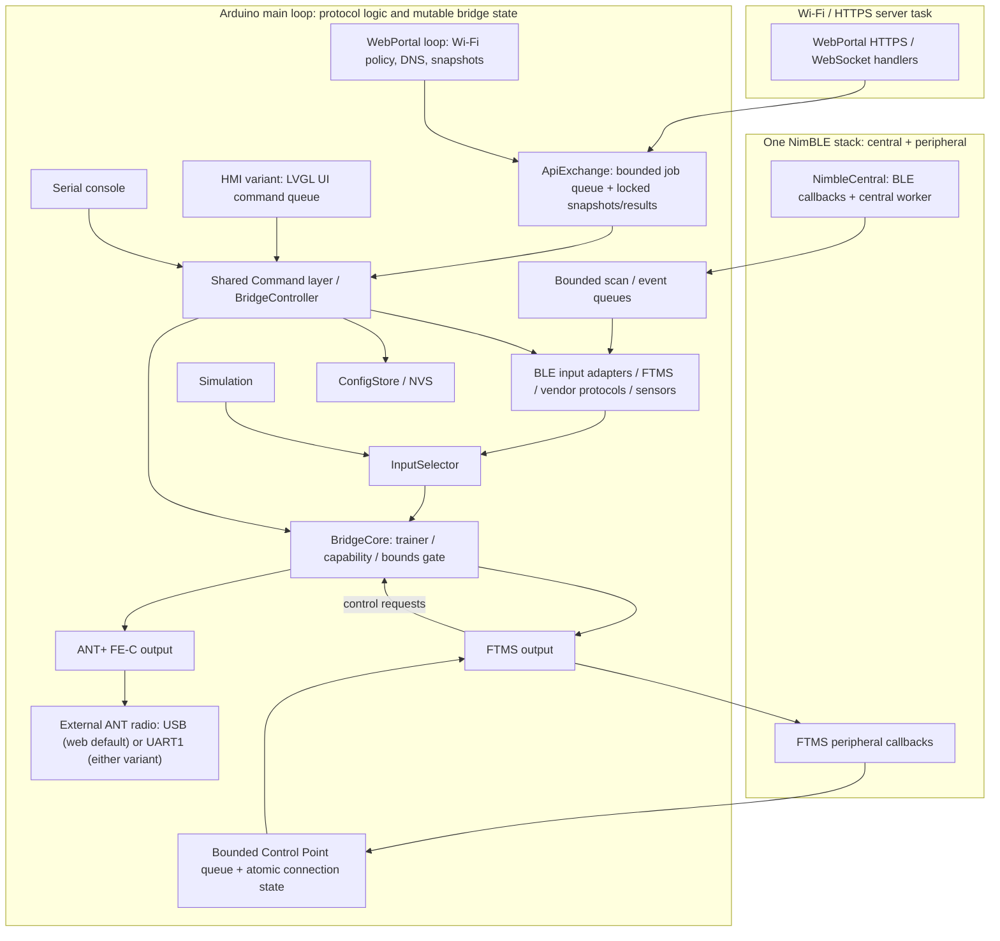

# ESP32 Smart Fitness Bridge

[](https://github.com/manuelh83/smartfitness-bridge/actions/workflows/ci.yml)

Firmware for ESP32-S3 boards that reads fitness equipment over BLE and forwards
measurements and supported trainer controls through Bluetooth FTMS. It is built in
two variants that share one core (see [Build variants](#build-variants)): a **web**
variant with Wi-Fi + web UI and an **HMI** variant with a local LVGL touch/knob UI
on the ELECROW CrowPanel 1.28" round rotary display.

> **License:** GPL-3.0-or-later (see [`LICENSE`](LICENSE)). The vendor protocols in
> `src/core/protocols/` and `include/core/protocols/` are ported from
> [`cagnulein/qdomyos-zwift`](https://github.com/cagnulein/qdomyos-zwift) (GPL-3.0),
> which makes the firmware a derivative work. The Sportstech/FitHome treadmill
> protocol is derived from
> [`syssi/esphome-treadmill-f15`](https://github.com/syssi/esphome-treadmill-f15)
> (Apache-2.0) and cross-checked against
> [`deniskie/ha-sportstech-walkingpad-integration`](https://github.com/deniskie/ha-sportstech-walkingpad-integration)
> (MIT).

## Overview and project status

Implemented: real BLE input scanning/pairing, FTMS and sensor decoders, initial
qdomyos-zwift vendor ports, reconnect/backoff, stale-data handling, FTMS output,
Wi-Fi setup and web UI, a shared console/API command layer, NVS configuration, and
a selectable output protocol: BLE FTMS, ANT+ FE-C with optional sensor channels
(external ANT radio over USB on web builds or UART on either variant; see
[ANT+ output](#ant-output)) or off. The UART transport is implemented but
unverified on hardware.
OTA is not implemented.

**Hardware test status** (the single place where hardware verification is tracked;
see the [supported-device table](#supported-devices-and-new-protocols)):

| Area | Status |
|------|--------|
| CrowPanel HMI: display, rotary encoder (turning/direction), knob button | Verified |
| End-to-end, **web** and **HMI** variant: **Wahoo KICKR** as FTMS input → subscribed characteristics shown in the HMI / web UI → bridge BLE FTMS output → **MyWhoosh** | Verified |
| Other BLE equipment and supported-device entries, Zwift and other apps, trainer control from apps, ANT+ output, reconnect/persistence, radio coexistence under load, safe physical trainer operation, readability on the real IPS panel | Unverified |

The post-PR-#10 [main CI run](https://github.com/manuelh83/smartfitness-bridge/actions/runs/38030185653)
passed both host tests and firmware build; the badge above tracks CI.

## Build variants

| | Web variant | HMI variant |
|---|---|---|
| PlatformIO env | `esp32s3dev` (default) | `crowpanel128` |
| Build flag | `-DSF_VARIANT_WEB` | `-DSF_VARIANT_HMI` |
| Board | ESP32-S3 DevKitC-1 N16R8 | ELECROW CrowPanel 1.28" ESP32-S3 Rotary Display (ESP32-S3R8, 8 MB PSRAM, 16 MB flash) |
| User interface | Wi-Fi + HTTPS web UI + REST/WebSocket API + Serial console | LVGL UI on the 240×240 round display (knob + touch) + Serial console |
| Extra libraries | ArduinoJson (HTTPS server: ESP-IDF `esp_https_server` from the core) | LVGL, LovyanGFX, Adafruit NeoPixel |
| Amazon Affiliate Link | [diymore ESP32-S3 N16R8](https://link.amazon/B04sCBCRH) | [ELECROW CrowPanel 1.28"](https://link.amazon/B0eHDSltG) |
| Optional extension with ANT+ Stick (for direct compatibility with e.g. Garmin Ant+ watches) <br> Amazon Affiliate Link | [Coospo Ant+ USB Stick](https://link.amazon/B0dalQtFe) <br> USB-C to USB-A OTG Adapter: [LogiLink AU0055](https://link.amazon/B01z26VJ2)| [Coospo Ant+ USB Stick](https://link.amazon/B0dalQtFe) <br> MX1.25 4Pin to USB Cable: [Waveshare MX1.25 4Pin to USB Cable](https://link.amazon/B07BNj1lk) |

Exactly one variant flag must be defined; `include/variant.h` stops the build with
`#error` otherwise. `src/main.cpp` contains the shared setup (config, BLE input,
simulation, `BridgeCore`, FTMS output, Serial console) and calls the variant hooks
`variant::begin()` / `variant::loop()`. Both variants use the same `Command`s and the
same `BridgeController`; the web variant renders its view model as JSON, the HMI
variant renders it with LVGL. The stored configuration (schema v6, including
Wi-Fi, output protocol and HTTPS fields) is identical; the HMI variant simply
never starts Wi-Fi.

## User interfaces

Both variants share an **LCARS-inspired** palette, Antonio typography, swept
frames, pill controls and telemetry gauges. Existing commands and safety
confirmations are unchanged. The screenshots are simulator/browser renders, not
photographs; for hardware test status see
[Overview and project status](#overview-and-project-status).


[Design system, HMI/web galleries and regeneration instructions](docs/hmi/README.md).

Source layout:

- `include/core/`, `src/core/` – shared core: BLE input, protocols, `BridgeCore`,
  FTMS output/profiles, `ConfigStore`/NVS, `Command` layer, `BridgeController` and
  the view model (`bridge_view_model.h`). It builds without any web or HMI source
  (checked by `make host-tests-core`).
- `include/variants/web/`, `src/variants/web/` – `WebPortal`, `ApiExchange`,
  `WifiPolicy`, JSON rendering (`web_json`) and the web app
  (`src/variants/web/assets/index.html`).
- `include/variants/hmi/`, `src/variants/hmi/` – LVGL screens (`hmi_ui`), the
  pure-C++ HMI model (`hmi_model`, strings in `hmi_strings`), board drivers
  (`hmi_hal`) and the pin header `board_crowpanel128.h`.
- `sim/` – headless LVGL host simulator that renders every HMI screen to PNG.

## Hardware and flashing

Targets: **ESP32-S3 DevKitC-1 N16R8** (web variant) and **ELECROW CrowPanel 1.28"
ESP32-S3 Rotary Display** (HMI variant). Both have 16 MB flash and 8 MB octal PSRAM
and use the Arduino framework, `qio_opi` memory mode and `partitions_16MB.csv`
partitions. Use the board's flashing connection (the CrowPanel has one USB-C port).

**Prerequisites:** Python 3.8+, Git, and PlatformIO Core (`pip install -U
platformio`), or the VS Code **PlatformIO IDE** extension, which bundles Core
(run the commands in its terminal). On Windows, a USB-UART driver (CP210x /
CH34x) is needed only when using the board's UART port.

### Build

```sh
git clone https://github.com/manuelh83/smartfitness-bridge.git
cd smartfitness-bridge
pio run -e esp32s3dev     # web variant
pio run -e crowpanel128   # HMI variant
```

- The first build downloads the toolchain, Arduino core, and pinned libraries; allow a few minutes.
- `scripts/embed_web_assets.py` runs automatically before compiling the web variant; no separate step is needed.
- Output files are in `.pio/build/<env>/`: `firmware.bin`, `bootloader.bin`, and `partitions.bin`. CI uploads them as `firmware-esp32s3dev` / `firmware-crowpanel128` artifacts.

### Optional web debug log

Uncomment `-DDEBUG_WEB` in the `esp32s3dev` environment's `build_flags` in
`platformio.ini`, then rebuild and flash. This captures queued application logs
and ESP-IDF logs in the **Debug** tab. The tab loads the current log
when opened and receives new output over the existing WebSocket (no polling).
**Logfile herunterladen** downloads `/debug/log` as `debug.log`;
**Anzeige leeren** only clears the browser display.
**Logging stoppen** (`POST /debug/logging` with `{"enabled":false}`) stops the
Debug-tab output and writes no further entries to `/debug.log` until
**Logging fortsetzen** is pressed; the Serial console keeps logging. The stop and
resume are marked in the log, and logging is enabled again after every reboot.
Every line in `/debug.log`, the Debug tab and the Serial console starts with the
uptime since boot as `HH:MM:SS.mmm` (e.g. `00:12:34.567 [BLE] connected; ...`).
The output includes state changes for BLE input, FTMS/ANT output, bridge source
and output selection, Wi-Fi, executed API commands, and WebSocket clients.
With `DEBUG_WEB`, every BLE input notification/indication is logged in the main
loop (all input protocols, without sampling), including ignored events and their
reason. API request bodies are not logged. Arduino-ESP32 2.0.17
implements task-context `log_x` macros using `log_printf` by default, so the
DEBUG_WEB-only configuration routes them through ESP-IDF logging for capture.
The same core's `isr_log_x` macros use `ets_printf` and are not captured; do not
log from ISRs. NimBLE-Arduino 1.4.3 uses `console_printf` for its Arduino logs
(rather than ESP-IDF `esp_log`), so those remain on UART; its level is limited
to warnings/errors to avoid flooding the console.

BLE diagnostics use these prefixes in both the Debug tab and LittleFS
`/debug.log` (download via `/debug/log`):

```text
[BLE-IN] #42 +3200 0x1826/0x2ad2 notify len=8: 44 00 90 01 a0 00 96 00
[BLE-READ] 0x1826/0x2acc len=8: 00 00 00 00 08 00 00 00
[BLE-OUT] 0x1826/0x2ad9 with response len=1: 00
[FTMS-IN] bike flags=0x000044 more=0 len=8 speed=4.00 cadence=80.00 power=150.00
[FTMS-CP] response to Request Control (0x00): success result=0x01
[BLE-IN] stats: notifications=20/5s, dropped(events=0, notifications=0, lifecycle=0), lastData=100 ms ago, stale=0
[BridgeCore] telemetry: speed=4.00 cadence=80.00 power=150.00 hr=- (stale=0)
```

`[BLE-IN]` includes a packet number and milliseconds since connection; unknown
characteristics use `idx=N`. Ignored events carry `(ignored: reason)`.
`[BLE-OUT]` also reports `WriteFailed`. Hex output uses a fixed buffer with at
most 64 payload bytes; `…(+N)` indicates omitted bytes (the length remains the
original received length). `[FTMS-IN]` shows only fields present in that packet,
or `decode=failed` / `dropped` with a reason. `[FTMS-CP]` reports commands,
responses, state changes, timeouts and retries. Fitness Machine Status `0x2ADA`
is optionally subscribed only in debug firmware and logged raw; it does not
count as a data characteristic for connection acceptance.

Statistics are emitted every five seconds while connected; drop counters are
transport lifetime totals and `lastData` is the age of the last accepted sample
(time since connection if none has arrived). Stale/fresh transitions are logged.
The bridge logs its outgoing telemetry once per second; `-` means unavailable.
The 16 KiB producer queue provides headroom for the expected 200–300 payload
bytes/s plus decoded output. No bounded queue can guarantee lossless logging
during arbitrarily long blocked downloads or overload: check `LOST OUTPUT` and
the BLE drop counters when diagnosing missing packets.
All these diagnostics, formatters and additional subscriptions compile out
unless both `ARDUINO` and `DEBUG_WEB` are defined; normal host tests are unchanged.

ANT+ diagnostics use the same `DEBUG_WEB` flag, Debug tab, and downloadable log
(USB stick or UART radio). They trace complete ANT serial messages at the shared
output layer, including received FE-C display controls:

```text
[ANT-IN] #42 +250 ms ch=0 device=1 type=17 msg=0x4f len=9: 00 31 ff ff ff ff ff 20 03 page=49 targetPower=200.00
[ANT-CP] requested page=49 targetPower=200.00
[ANT-CP] page=49 result=pass(0x00) command-status recorded
[ANT-OUT] ch=0 device=1 type=17 msg=0x4e len=9: 00 10 19 00 00 88 13 78 33 page=16 speed=18.00 km/h hr=120.00 tx=accepted
[ANT-IN] stats: messages=20/5000 ms dropped=0 writeErrors=0 radioErrors=0 lastData=100 ms stale=0
```

`[ANT-IN]` numbers every parsed message; `+N ms` is the interval since the
previous incoming message (zero for the first). `ch` is the radio channel index;
`device` and `type` identify its configured ANT+ device number/type when known.
`ch=-` means a radio-wide or unknown message. `msg` is the ANT message ID
(`0x40` response/event, `0x4e` broadcast, `0x4f` acknowledged data).
`len` and hex cover the serial **payload**, including the channel byte, not
framing/checksum. Network-key writes are redacted, including private overrides.
`page` identifies the data page; speed/cadence's unpaged counter payload uses
`page=-`. Concise decoded fields include power (W), cadence (rpm), speed (km/h),
heart rate (bpm), requested controls, and page 71 command status; `-` means
unavailable. Unknown messages/pages remain visible as raw hex.

`[ANT-OUT]` logs every write with `tx=accepted` or `tx=failed`; accepted means
the transport accepted the write, **not** that a trainer applied a command.
`[ANT-CP]` traces display requests, local command results, configuration
responses, radio transfer events, timeouts and retries. Page 71 replies show
the command result on the outgoing line. A radio transfer acknowledgment is
not trainer control acceptance; ANT controls still follow the existing core
gate and BLE control path.

ANT statistics appear at most once every five seconds while enabled and the
radio is connected. They report the message count over the actual window in
milliseconds, parser-lifetime dropped frames (bad checksum/oversized length),
write/radio-response errors since `begin()`, and the last accepted display-page
age (`-` before any); `stale=1` means no display page within five seconds.
Regular radio TX events do not refresh that age. All messages are logged without
sampling, like BLE input; multiple ANT channels increase log volume, so monitor
`LOST OUTPUT` for debug-queue overload. No protocol timing, retries or control
decisions are changed, and these diagnostics compile out of non-debug builds.

ESP-IDF logging defaults to **Info** with `DEBUG_WEB`. To change it, uncomment
`-DDEBUG_WEB_IDF_LEVEL=3` next to `-DDEBUG_WEB` in `platformio.ini` and choose
1=Error, 2=Warning, 3=Info, 4=Debug or 5=Verbose. Higher levels can fill the
512 KiB log quickly: rotation discards the previous contents when the next
batch exceeds the limit, and queue overflow is reported as lost output.
The central `DBG_SERIAL` output still writes to Serial and additionally buffers
output for LittleFS `/debug.log`. The file is deleted on every boot and never
exceeds **512 KiB (524288 bytes)**; when full, the old contents are discarded
before the next batch is written. A dedicated task batches flash writes;
queue overflow or rejected ISR writes are reported as lost output. Do not call
formatted `Print` methods from an ISR; keep interrupt handlers free of logging.
Downloads hold a consistent file snapshot while streaming. A slow download can
temporarily delay other web requests/live pushes and fill the bounded log queue;
the control loop never waits on the file lock.

`partitions_16MB.csv` explicitly preserves **all offsets and sizes** from the
previous Arduino `default_16MB.csv`: two 6400-KiB app slots, unchanged NVS and
coredump, and a **3456-KiB filesystem** at `0xc90000`. This leaves ample room for
the log and filesystem metadata. Web assets remain embedded in firmware, so
they do not consume filesystem space. The web environment selects LittleFS;
startup checks free space and warns if the full log cannot fit.
Without `DEBUG_WEB`, no logger, filesystem mounting, debug assets or debug
endpoint is compiled in; Serial output and the existing flash layout are unchanged.
CI builds the web firmware both with and without this flag, plus the normal HMI variant.
Like the existing web interface, the log is available to connected clients;
enable debugging only on trusted networks and check logs before sharing them.

### Flash and monitor

```sh
pio run -e esp32s3dev -t upload     # or: -e crowpanel128
pio device monitor -b 115200
```

- The DevKitC-1 has two USB ports. The default web variant uses the port labelled **UART** for flashing, power and the Serial console (`ARDUINO_USB_CDC_ON_BOOT=0`), because the native port labelled **USB** is the USB host port for the ANT+ stick (see [ANT+ output](#ant-output)). UART ANT builds do not use the USB host transport.
- If upload does not start, hold **BOOT**, press **RST**, release BOOT, and retry.
- Select ports with `--upload-port` / `--port`, e.g. `COM5` or `/dev/ttyACM0`.
- `crowpanel128` uploads at 115200 baud because esptool's switch to 921600 on the native USB port can fail with `A fatal error occurred: No serial data received.` Upload speed stays the same because the native USB port ignores the baud rate. If `esp32s3dev` shows the same error on its native **USB** port, add `-O "upload_speed=115200"` to `pio run` or use the **UART** port.

Serial is **115200 baud** (web variant: UART port; HMI variant: USB CDC); it prints
boot/configuration and Wi-Fi information.
An external ANT radio is **optional**: BLE FTMS works without it. The web variant
defaults to a USB ANT+ stick (with USB-OTG adapter); either variant can instead
use a UART ANT module when its build flags are configured. See
[ANT+ output](#ant-output) and [hardware decisions](docs/hardware-decisions.md).

**Optional host tests:** `make host-tests` (requires `make` and `g++` with C++17; on
Windows, use WSL).

**Troubleshooting:** `platform = espressif32` is unpinned, while NimBLE-Arduino
1.4.3 requires Arduino core 2.0.x. If the build fails with NimBLE/`esp_` errors,
pin a 6.x `espressif32` platform version that ships Arduino core 2.0.17 (check the
[Dependency compatibility](#dependency-compatibility) section and platform release
notes for the exact version), then run `pio run -t clean` and rebuild with
`pio run -e esp32s3dev`.

## HMI variant (CrowPanel 1.28")


### Board pins

All pins are in [`include/variants/hmi/board_crowpanel128.h`](include/variants/hmi/board_crowpanel128.h),
taken from ELECROW's official repository
[`Elecrow-RD/CrowPanel-1.28inch-HMI-ESP32-Rotary-Display-240-240-IPS-Round-Touch-Knob-Screen`](https://github.com/Elecrow-RD/CrowPanel-1.28inch-HMI-ESP32-Rotary-Display-240-240-IPS-Round-Touch-Knob-Screen)
(commit `63e407f`): factory firmware `RotaryScreen_1_28.ino`, the lesson examples and
the schematic *ESP32 Display-1.28-V1.0*. Summary: GC9A01 on SPI (SCLK 10, MOSI 11,
DC 3, CS 9, RST 14), backlight PWM GPIO 46, LCD power enable GPIO 1, CST816D touch on
I2C (SDA 6, SCL 7, INT 5, RST 13, address 0x15), encoder A 45 / B 42, button 41
(active low), 5 × WS2812 on GPIO 48. Items marked `TODO(verify)` in the header
(GPIO 2 5 V output enable, LED count/order) could not be confirmed beyond the
example code.

Drivers: LovyanGFX 1.2.7 (GC9A01, DMA flush), a small CST816D reader, and an
interrupt-driven quadrature decoder (4 quarter-steps per detent) read by the LVGL encoder input. LVGL 9.2.2 runs on the main
loop with one partial 240×40 RGB565 draw buffer (internal DMA RAM, PSRAM fallback).

### Navigation

| Input | Action |
|---|---|
| Turn knob | Move focus / change value / cycle dashboard metric |
| Press knob | Select, confirm a value |
| Hold knob (~0.4 s, LVGL long press) | Back |
| Tap | Select |
| Swipe right | Back (on the dashboard: previous metric) |
| Swipe left | Next dashboard metric |

Screens (same interactions as the web UI):

- **Dashboard** – arc gauge for the selected metric (power, cadence, speed, heart
  rate, incline, distance, time), target, connection/trainer/control state, machine
  profile and FTMS client state. Press opens the menu.
- **Devices** – start/stop scan, scan results (name, adapter, 4-bar signal-strength icon instead of numeric RSSI), pair/connect
  with optional adapter override (all adapters incl. `ifit-model-N` and WalkingPad
  cipher profiles), disconnect, unpair, simulation on/off.
- **Control** – target power/resistance/incline/speed. Values are set with the knob
  (fine steps) or the +/- buttons and applied with a knob press. Rejections show the
  `CommandResult` message. **Treadmill speed changes need an explicit Confirm**
  (Cancel is focused by default); the editor starts from the measured speed, and the
  bridge never starts the belt by itself. "Stop belt" sends speed 0.
- **Settings** – FTMS name (presets or on-screen keyboard), output protocol (a
  press cycles BLE FTMS → ANT+ → Off when an ANT transport is configured;
  otherwise ANT+ is skipped), BLE service and full multi-channel ANT+ selection,
  output profile, save, load, factory reset (two
  confirmations), restart, firmware version, brightness, screen timeout and LED
  ring. Brightness/timeout/LED ring are stored in a separate NVS namespace
  (`sfhmi`), not in the shared configuration.

With UART configured, the HMI exposes FE-C, Bicycle Power, Heart Rate, Bicycle
Speed/Cadence and SDM channel selection and per-channel status through the shared
transport-configured state. Without a configured transport it shows **ANT unavailable**.
This reuses the existing multi-channel output and schema v6 service masks; no
configuration-schema change is required.

The status refreshes at 5 Hz; UI callbacks only enqueue `Command`s that the main
loop executes. UI strings are centralised in `src/variants/hmi/hmi_strings.cpp`
(English; a German table can be added, but needs a font with umlauts).

### Simulator and screenshots

```sh
git clone --depth 1 --branch v9.2.2 https://github.com/lvgl/lvgl.git .cache/lvgl
make hmi-screenshots          # writes screenshots/*.png
```

The headless simulator renders every screen from the shared view model with fake
data and runs a knob-only walkthrough. CI uploads the PNGs as the
`hmi-screenshots` artifact.

### HMI limitations

- No Wi-Fi, web UI or REST/WebSocket API in this variant (Serial console stays).
- Only the built-in Montserrat fonts (ASCII); German umlauts need a custom font.
- The display, rotary encoder (turning/direction), and knob press are verified on
  hardware. Touch operation and the pin TODOs (GPIO 2 5 V enable, LED count/order)
  remain unconfirmed.

## Architecture



The diagram shows the web variant; in the HMI variant the Wi-Fi block is absent and LVGL runs on the main loop, pushing `Command`s into a bounded queue that the loop executes. Everything that runs on the Arduino `loop()` – the core, the adapters' protocol logic, the command executor – is single-threaded. BLE callbacks (NimBLE host task and the central worker task) and HTTPS/WebSocket handlers (`esp_https_server` task) only push into bounded, lock-protected queues; the loop drains them.

- `smartfitness::BridgeCore` (`include/core/bridge/bridge_core.hpp`): one canonical core header shared by firmware and host tests. Tracks disconnected, connected/read-only, trainer, and control-ready states.
- `BtDeviceAdapter`: equipment input interface. Implementations: `SimulatedDeviceAdapter`, `BleInputAdapter` (real BLE devices) and `InputSelector`, which forwards to the BLE input when a device is paired and BLE input is enabled, otherwise to the simulation.
- `BleInputAdapter` (`include/core/ble_input_adapter.h`): scanning, pairing, connection lifecycle, stale telemetry. It talks to the radio through the `CentralTransport` interface (`include/core/ble/central_transport.hpp`); `NimbleCentral` implements it on the firmware, `tests/host/fake_central.hpp` in host tests.
- Protocols (`include/core/protocols/`): pure C++ `SourceProtocol` implementations (FTMS, sensors, vendor ports) and the adapter registry.
- `AntOutput` / `FtmsOutput`: the two outputs; the configured `OutputProtocol` (`include/core/bridge/output_protocol.hpp`) enables at most one of them. `FtmsOutput` is a BLE FTMS peripheral (see below); `AntOutput` provides FE-C and selectable sensor master channels on an external ANT radio reached through `smartfitness::ant::AntTransport` (`include/core/ant/ant_transport.hpp`; ANT serial messages in `ant_message.hpp`, FE-C pages in `fec_codec.hpp`). The web variant defaults to the ESP-IDF USB host transport (`include/variants/web/ant_usb_transport.h`); either variant uses UART1 instead when UART build flags are configured.
- FTMS codec (`include/core/ftms/ftms_codec.hpp`): pure C++ encoding/decoding of FTMS characteristics, used by both the output and the FTMS input.
- `BridgeController` (`include/core/bridge_controller.h`): the variant-neutral command executor. The Serial console, the web API and the HMI all produce `Command` values (`include/core/bridge_commands.h`) and run them through `BridgeController::execute`; it also builds the status/scan/config view model (`include/core/bridge_view_model.h`).
- Web variant: `web_json` (`include/variants/web/web_json.h`) renders the view model as JSON; `ApiExchange` (`include/variants/web/web_api.h`) validates API JSON and hands jobs to the loop; `WebPortal` (`include/variants/web/web_portal.h`, firmware only) owns Wi-Fi, DNS/captive portal, mDNS and the HTTPS/WebSocket server (plus the port-80 redirect); `tls_cert` (`include/variants/web/tls_cert.h`) creates and stores the self-signed certificate; `WifiPolicy` (`include/variants/web/wifi_policy.h`) decides AP/STA/fallback.
- HMI variant: `hmi::Model` (pure C++, host-tested) turns the view model into screen content and UI actions into `Command`s; `HmiUi` builds the LVGL screens; `hmi_hal` drives display, touch, encoder, backlight and LED ring.
- `ConfigStore` (`include/core/config_store.h`): configuration persisted through a `ConfigBackend` (NVS on the firmware, memory in host tests). See [Persistent configuration](#persistent-configuration).
- Input and output are configured independently: `ftmsInput` means "use the paired BLE device as input (auto-connect)"; `outputProtocol` (`off`, `ble-ftms`, `ant-fec`) selects the output.

## First setup walkthrough

1. Flash the board and open Serial at 115200. With no stored home-network SSID,
   it opens the WPA2 SoftAP **`SmartFitness-XXXX`** (`XXXX` is the last two MAC
   bytes) with default password **`smartfitness`**.
2. Join that network. Captive-portal DNS and OS probe redirects should open the
   UI; if not, open **`https://192.168.4.1/`** (or the AP IP printed on Serial).
   The browser warns about the self-signed certificate once; see
   [HTTPS and the self-signed certificate](#https-and-the-self-signed-certificate).
3. Open **Settings**, enter the home Wi-Fi SSID and password, and choose a new AP
   password (8–63 printable ASCII characters). Click **Save**, wait for the result,
   then **Restart**. Console equivalent:
   ```text
   wifi HomeNetwork your-home-passphrase
   ap-pass your-new-ap-passphrase
   save
   restart
   ```
   Use the web UI for SSIDs containing spaces. `wifi <ssid>` sets an open network;
   `wifi-clear`, then `save` and `restart`, restores AP-only operation.
4. On the home network, open **`https://smartfitness.local/`** (mDNS) or the station
   IP. If STA fails to connect within **20 s** at boot or after link loss, the AP
   is added (AP+STA); STA keeps retrying. After STA has been connected for **2 min**
   and no AP clients remain, the fallback AP closes. Policy is checked once/second.

**Security warning:** change the shared default password before normal use.
The web UI and API are encrypted with TLS (HTTPS, self-signed certificate; can be
switched off, see below) but have **no authentication**; anyone on the AP/home network can
control, pair, erase settings, or restart the bridge. Do not port-forward it or
use an untrusted network. POST requests require `Content-Type: application/json`,
even with no body. A supplied `Origin` must be `https://smartfitness.local`, the
current STA IP, or the SoftAP IP (optional `:443`); foreign/null and `http://` origins are rejected.
With HTTPS switched off the same hosts are accepted only as `http://` (optional `:80`).
No CORS access is enabled. This blocks browser CSRF, **not** clients already on
your network; there is no API token. WebSocket upgrades also reject foreign origins.
Passwords are never returned by API snapshots/results. Serial prints only the
factory-default AP password; custom passwords are shown as `(custom)`, and the
home Wi-Fi password is never logged. Credentials are stored in NVS.
AP passwords must be 8–63 printable ASCII characters. Invalid stored AP passwords
fall back to the default while preserving other valid settings; a failed SoftAP
start is logged and retried with the default. Change that default before normal use.
Wi-Fi/AP edits (including factory reset) require a restart to change the running network.

### HTTPS and the self-signed certificate

- HTTPS is **on by default** and can be switched off in **Settings → HTTPS**
  (or console `https off`, then `save` and `restart`; API `{"https":false,"save":true}`).
  The change applies after a restart; the settings page then opens the new
  address itself. With HTTPS off the web UI, REST API and WebSocket
  (`ws://<host>/ws`) run **unencrypted on port 80** (up to 7 connections), there is
  no port-443 listener, captive-portal probes go to `http://<SoftAP IP>/`, and
  mDNS announces `_http._tcp`. Passwords entered in the UI then cross the network
  in clear text. If the certificate cannot be created or the HTTPS server fails to
  start, the bridge falls back to plain HTTP so the interface stays reachable.
  Factory reset switches HTTPS back on. The stored certificate is kept while
  HTTPS is off.
- With HTTPS on, the web UI, REST API and WebSocket (`wss://<host>/ws`) are served only over
  **HTTPS on port 443** (ESP-IDF `esp_https_server`, TLS 1.2). Port 80 only answers
  with `302` redirects to the same path on HTTPS; captive-portal probes and foreign
  hosts are sent to `https://<SoftAP IP>/`.
- On first boot each bridge generates its own **ECDSA P-256** key and a
  **self-signed** X.509 v3 certificate with its hardware RNG (takes about a second;
  Serial shows `[Web] generating self-signed TLS certificate`). Subject/SAN:
  `smartfitness.local`, SAN IP `192.168.4.1` (SoftAP); `CA:FALSE`, `serverAuth`.
- The certificate **never expires**: it is valid from 2025-01-01 until
  `9999-12-31 23:59:59 UTC`, the RFC 5280 value for "no well-defined expiration
  date". The bridge has no real-time clock, so this also avoids clock-related errors.
- Key and certificate are stored in NVS namespace `sftls`, separate from the
  configuration: factory reset, configuration changes and firmware updates keep
  them (and the browser exception). Only erasing the whole flash
  (`pio run -t erase`) creates a new certificate. The private key is stored
  unencrypted in flash (no flash encryption).
- Browsers show a warning such as *"Your connection is not private"* because no
  public CA signed the certificate. Check the certificate details and accept the
  exception once per browser (*Advanced → Proceed*). The connection is still
  encrypted; without verifying the certificate the browser cannot rule out an
  attacker on the same network. Optionally import the certificate (download it via
  the browser's certificate viewer) as trusted for `smartfitness.local`; Apple
  devices reject trusted TLS certificates valid for more than 825 days, so there
  the exception remains the way to go. A station IP is not in the SAN, so
  `https://<station IP>/` always shows the warning.
- Captive-portal mini browsers (Android/iOS sign-in pop-ups) may refuse the
  self-signed certificate; open `https://192.168.4.1/` in the normal browser instead.
- Each TLS session uses about 35 kB of internal RAM; the server keeps at most
  **4** HTTPS connections (least-recently-used ones are closed first; WebSocket
  listeners count as recently used on every broadcast) and 2 redirect connections.

## Pairing walkthrough

1. Wake the equipment, enable its pairing mode, and disconnect competing apps.
2. Open **Devices → Scan**; select a result by name/address, RSSI, services, and
   detected adapter. Optionally override the adapter, then choose **Pair**.
   The pairing scan runs 30 s with a high-duty scan window (90 of 97 ms) and
   duplicate reports; advertisements and scan responses are merged into one
   entry per address. Entries without an advertised name show the manufacturer
   (from manufacturer data) or the advertised service in grey; devices with no
   name, no known service and no detected protocol are grey and listed last.
3. Pairing saves the source and enables BLE input immediately. Watch the Dashboard
   link state and metrics; a successful pairing command means “connecting”, not
   that the equipment has already connected. **Connect**, **Disconnect**, **Unpair**
   and **Use simulation** are also available on Devices.

Console equivalent (substitute the actual scan address/type):

```text
scan 10
scan-results
pair aa:bb:cc:dd:ee:ff auto random
status
disconnect
connect
sim
```

Full syntax: `pair <addr> [adapter|auto] [public|random]`. When type is omitted,
the scan result supplies it; for an explicit type with automatic detection use
`auto` in the adapter position. An explicit registered adapter also allows pairing
an address not in the current scan list; detection without a scan result cannot work.
`sim` disables BLE input in RAM without forgetting the pairing; `connect` selects
the saved BLE source again. `save` persists that input toggle.

### Connection lifecycle and stale data
- The paired device is connected on boot when BLE input is enabled. Before each attempt,
  `searching` probes for its advertisement for up to 3 s unless one was seen less than
  2 s ago. FTMS Service Data ends the probe immediately; otherwise it waits up to
  500 ms for a scan response. An absent device backs off with `not-advertising`
  (wake it, move it closer, or disconnect other apps). Broadcast-only inputs keep listening.
- Connection setup discovers GATT once, then uses cached services/characteristics.
  On NimBLE 1.4.3, the public `discoverAttributes()` traversal also caches
  descriptors and reports discovery errors (the individual vector getters hide them).
  Discovery/read/subscription progress renews the 15 s inactivity deadline, bounded
  by 45 s total. Timeouts log elapsed time, phase and result counts. Failures and
  link loss reconnect with exponential backoff (1 s … 30 s).
- FTMS subscribes to every machine type advertised in Service Data plus Control
  Point indications. Without Service Data it reuses the last type mask (RAM only),
  or subscribes only to FTMS data characteristics present in GATT; absent optional
  characteristics do not appear as failed subscriptions.
- If a connected device delivers no data for 5 s, its telemetry is marked stale and invalidated (outputs stop reporting the metrics). If no data arrives for 20 s, the link is dropped and reconnected.
- Stale treadmill telemetry also disables treadmill controls until fresh data
  restores readiness. The FTMS input handshake never automatically sends
  Start/Resume to a treadmill, cross-trainer, step/stair climber or rower. Bike
  initialization sends it only with confirmed bike identity, not an ambiguous
  machine.
- The peer currently connected to the FTMS output is never offered in scan results and never connected to as an input.

## Supported devices and new protocols

“Implemented” means the adapter is registered and has a device matcher and
decoder; it does not mean every model or firmware has been verified. “Tested”
means the input and named output were confirmed with real equipment and the
listed app. Adapters marked manual are selected in the adapter list while
pairing. Please share test results in an issue, including device, firmware,
output protocol, and app.

| Manufacturer / model family | Device type | Input protocol / adapter IDs | Auto-detect or manual | Tested on hardware | Output tested (BLE FTMS / ANT+) | Tested with (device / app) |
|---|---|---|---|---|---|---|
| Standard FTMS fitness machines | Bike, treadmill, cross trainer, step/stair climber, rower | `ftms` | Auto | ✅ Wahoo KICKR only | ✅ BLE FTMS; ANT+ not tested | Wahoo KICKR via `ftms` / MyWhoosh (web and HMI; CrowPanel 1.28") |
| Standard fitness sensors | Cycling power, speed/cadence, heart rate | `cps`, `csc`, `hrs` | Auto | 🧪 | — | — |
| Keiser M3i | Bike | `keiser-m3i` | Auto (broadcast) | 🧪 | — | — |
| Echelon Connect, Row, Stride, Stride 4, stair climber | Bike, rower, treadmill, stair climber | `echelon`, `echelon-*` | Auto | 🧪 | — | — |
| Domyos / Decathlon | Bike, treadmill, elliptical, rower | `domyos`, `domyos-tm`, `domyos-el`, `domyos-row` | Auto | 🧪 | — | — |
| Schwinn IC4/IC8, 170/270; matching Bowflex bikes | Bike | `schwinn-ic4`, `schwinn-170` | Auto | 🧪 | — | — |
| Yesoul | Bike | `yesoul` | Auto | 🧪 | — | — |
| iFit / NordicTrack / ProForm; Bowflex T216 | Bike, treadmill, elliptical, rower | `ifit-*`, `ifit-model-1…97`, `bowflex-t216`, `proform-rower`, `proform-750r`, `proform-sport-rl` | Auto and manual profiles | 🧪 | — | — |
| Nautilus / Bowflex | Bike, treadmill, elliptical | `nautilus-*`, `bowflex-tm` | Auto and manual variants | 🧪 | — | — |
| Tacx Neo/Flux; Elite legacy, DR, Misuro | Bike / trainer | `tacx-fec`, `elite-*` | Auto | 🧪 | — | — |
| Wahoo KICKR legacy; KICKR RUN | Bike / treadmill | `wahoo-legacy`, `kickr-run` | Auto | 🧪 | — | — |
| Concept2 PM5 / SkiErg | Rower, SkiErg | `concept2-pm5`, `concept2-skierg` | Auto | 🧪 | — | — |
| FitShow / FitPlus / S-Node / NoblePro / Merach | Treadmill, bike, rower | `fitshow-*`, `fitplus-*`, `snode-bike` | Auto and manual variants | 🧪 | — | — |
| Toorx / TRX App Gate, including i-Running, Reebok, Adidas, DKN | Treadmill, bike, elliptical, rower | `trx-*` | Auto and manual variants | 🧪 | — | — |
| Sportstech / SportPlus / Carefitness / Pafers | Treadmill, bike, elliptical, rower | `sportstech-*`, `sportsplus-*`, `carefit-bike`, `sp-ht-9600ie`, `pafers-*` | Auto and manual variants | 🧪 | — | — |
| Horizon / Paragon, Spirit, Sole, Kingsmith / WalkingPad | Treadmill | `horizon-*`, `spirit-*`, `sole-*`, `walkingpad-*` | Auto and manual variants | 🧪 | — | — |
| TRUE, Technogym MyRun, LifeSpan, Octane, ZiPro, ESLinker, Sperax, Focus, DeerRun/PitPat, Activio, Life Fitness, ShuaA5 | Treadmill | `true-*`, `technogym-myrun`, `lifespan-tm`, `octane-*`, `zipro-tm`, `esanglinker`, `eslinker-costa`, `sperax-tm`, `focus-tm`, `deerrun-pitpat`, `activio-*`, `lifefitness-tm`, `shuaa5-tm` | Auto and manual variants | 🧪 | — | — |
| Flywheel, Sole, Kettler, Technogym, Inspire, Keep, MCF, XCX, Chrono, Volava, Ultrasport, Skandika, PitPat, Freebeat, MEPANEL, Apex, NPE CABLE, CycleOps, Joroto/BGYM, Renpho, Horizon GR7 | Bike | `flywheel`, `sole-*`, `kettler-c12`, `technogym`, `inspire`, `keep-bike`, `mcf-bike`, `xcx-bike`, `chrono-bike`, `volava`, `ultrasport`, `skandika-*`, `pitpat-bike`, `freebeat-boom`, `mepanel`, `apex-bike`, `npe-cable`, `cycleops`, `csc-bike`, `lifespan-bike`, `renpho`, `horizon-gr7` | Auto and manual variants | 🧪 | — | — |
| BH, YPOO, Sole, Xterra, Octane Q37, SmartRow, Sunny | Elliptical, rower, stepper | `bh-elliptical`, `ypoo-*`, `sole-elliptical`, `xterra-xe88`, `octane-q37`, `smartrow`, `sunnyfit-stepper` | Auto and manual variants | 🧪 | — | — |

Legend: ✅ tested on hardware · 🧪 host tests with synthetic data only · — no
hardware-verified output. ANT+ output has not been tested on hardware. The
[supported-device guide](docs/supported-devices.md) has match rules, metrics,
controls, and attribution.

### Not supported

Peloton/DFC, Bluetooth Classic (RFCOMM), ANT+/USB/Wi-Fi/ADB inputs, accessories
without fitness data, and Kinetic (licensed protocol) are not supported. See
[the supported-device guide](docs/supported-devices.md) for details.

To add a protocol:
1. Implement pure C++ `SourceProtocol` in `include/core/protocols/` and `src/core/protocols/`:
   `plan()` declares reads/subscriptions, `onRead()`/`onNotify()` decode bytes,
   `control()`/`tick()` queue writes drained by `takeWrite()`; advertisement-only
   inputs use `onAdvertisement()`.
   Long handshakes can request bounded `startupTimeoutMs()` grace. Dynamic GATT
   discovery is opt-in through `ConnectPlan`; explicitly allowlist write UUIDs
   and receive the resolved endpoint through `onWriteEndpoint()`.
2. Add an id (`[a-z0-9_-]`, at most 16 characters), matcher, factory, and priority
   to `kProtocols` in `src/core/protocols/registry.cpp`, or expose a family's
   `descriptorCount()`/`descriptorAt()` and append it to `kFamilies` (append only:
   the order is the detection tie order). Highest matching priority wins;
   avoid broad vendor matches stealing unrelated devices from standard protocols.
3. Add host tests with representative byte samples and malformed/truncated packets
   (in `tests/host/test_ble_input.cpp` or a family test file registered in the
   Makefile and `tests/host/test_main.cpp`), and add every new id to the expected
   map in `testProtocolProfiles`.
4. For ports, retain a GPL attribution header with upstream project, source file,
   revision, and derived behavior; label synthetic vectors versus hardware captures.

## Using with apps

### Zwift / MyWhoosh

Connect the source first, then pair the bridge's advertised name (default
`SmartFitness Bridge`) as an FTMS power/cadence source and controllable trainer.
Use only one app/client at a time. ERG requires source power control; simulation
grade requires incline control. Read-only sources do not become controllable trainers.
For the app compatibility tested on hardware see
[Overview and project status](#overview-and-project-status).

### Treadmill apps

Connect the treadmill source before pairing the bridge with **Zwift Run** for
speed/incline/heart-rate telemetry. Telemetry compatibility does **not** guarantee
that Zwift can control belt speed. **Kinomap** and **QZ** control behavior depends
on the client, source capabilities, and firmware; hardware interoperability is
unverified. Read-only treadmills remain read-only.

### nRF Connect smoke test

1. Run `sim` (not `scan`) on Serial, and ensure `output ble-ftms` and `trainer on`.
2. Scan for service `0x1826`, connect to `SmartFitness Bridge`, and subscribe to
   Indoor Bike Data `0x2AD2`. Expected simulation bytes:
   `44 02 C4 09 A0 00 96 00 78` (25 km/h, 80 rpm, 150 W, 120 bpm).
3. Enable Control Point `0x2AD9` indications; write `00` to request control
   (response `80 00 01`), then `05 C8 00` for 200 W (`80 05 01`).
   Simulation telemetry should change to 200 W.
4. Run `trainer off`; a power write `05 FA 00` should return `80 05 05`
   (Control Not Permitted). Restore `trainer on`; disconnect when done.

For a controllable treadmill source, select automatic/treadmill output, reconnect
the client after a profile change, and subscribe to Treadmill Data `0x2ACD` instead.
Enable Control Point indications and write Request Control `00` → `80 00 01`,
then target **8 km/h** `02 20 03` → `80 02 01` if the source accepts it.
**This speed command can cause real belt movement.** Test only with a clear belt
and a person at the physical controls; the safety key and physical stop remain
primary. Start/Resume never starts the belt. Disconnects and stale telemetry do
not send stop or speed commands: do not rely on the bridge as an emergency stop.
Treadmill Start/Resume returns Operation Failed (`80 07 04`) because there is no
safe source start primitive.

### Garmin

Do not assume the fenix 6/6 Pro can consume/control this FTMS output.
[HD-002](docs/hardware-decisions.md#hd-002-garmin-watches-eg-fenix-6-pro-and-bluetooth-ftms)
records the CPS/HRS output and multi-client work needed for recording. Watches that
support ANT+ FE-C trainers can use the [ANT+ output](#ant-output)
(external USB or UART ANT radio; not verified on hardware).

## Serial console
The Serial monitor (115200 baud, newline-terminated) accepts the same commands as the web UI:

| Command | Effect |
|---|---|
| `help`, `status` | Help and a one-line status (includes `input=ble/sim link=… paired=… stale=1`) |
| `scan [seconds]` | BLE scan (1–60 s, default 10 s); without BLE input support it connects the simulation |
| `scan-stop`, `scan-results` | Stop scanning / list results (address, name, RSSI, detected adapter) |
| `pair <aa:bb:cc:dd:ee:ff> [adapter\|auto] [public\|random]` | Persist source and enable BLE input; explicit adapter permits an unscanned address |
| `connect`, `disconnect`, `unpair` | Reconnect the paired device, disconnect, forget the pairing |
| `sim` | Use the simulated device as input (150 W, 80 rpm, 25 km/h, 120 bpm) |
| `power <W>`, `resistance <%>`, `incline <%>`, `speed <km/h>` | Control through the `BridgeCore` gate; prints the rejection reason |
| `trainer on/off` | Toggle simulated trainer detection only (does not promote real equipment) |
| `output off\|ble-ftms\|ant-fec` | Select the output protocol. `ble-ftms`: FTMS advertising; `ant-fec`: ANT+ on the configured USB/UART transport (rejected without a configured ANT transport); `off`: no output (the FTMS client is disconnected, advertising stops and ANT channels are closed) |
| `ftms-input on/off` | Select paired BLE input / simulation; independent of output |
| `ftms-name <name>` | Set 1–20 printable ASCII characters; spaces are allowed |
| `ftms-profile <auto\|bike\|treadmill\|cross-trainer\|rower\|step-climber\|stair-climber>` | Select output profile; `auto` follows input; every profile is sent natively; `save` persists |
| `wifi <ssid> [password]`, `wifi-clear`, `ap-pass <password>` | Wi-Fi settings (save + restart to apply) |
| `https on/off` | Web interface over HTTPS (default) or plain HTTP (save + restart to apply; web variant only) |
| `save`, `load`, `factory-reset`, `restart` | Persistence and reboot |

`status` includes `output=off|ble-ftms|ant-fec` and `ftms-out(advertising=…,client=…,control=…)`: whether the FTMS output is advertising, whether a BLE client is connected, and whether that client has been granted control via Request Control. With `output=ant-fec` it adds `ant(link=…,device=…,display=…,control=…)`: the channel state (`waiting-for-stick`, `resetting`, `configuring`, `open`, `no-hardware`), the ANT+ device number, whether a display sent a page in the last 5 s and whether it controls the trainer.
`input-profile`, `output-profile` and `ftms-profile` show the active input type,
effective output type and configured override respectively.
It also includes `dropped(scans=…,events=…,notifications=…,commands=…)` for BLE
transport queue overflow. These cumulative counters are available as
`input.dropped` in `/api/status`; scan-result-list overflow remains the separate
`dropped` field in `/api/scan/results`.
Lines are newline-terminated, limited to 96 characters, and case-sensitive.
Use literal `on` or `off`, not `on/off`. Settings are RAM edits until `save`,
except pairing/unpairing, which persist their own changes immediately.

## Web interface
### Using the UI
The single-page app (`src/variants/web/assets/index.html`, web variant only, plain HTML/JS/CSS, gzipped into flash at build time by `scripts/embed_web_assets.py`, no external resources) has four tabs:
- **Dashboard:** live power, cadence, speed, heart rate, incline, control target, input/link/stale state, active input profile, effective output profile, trainer/control state and the active output (BLE FTMS client state, or ANT+ stick/channel/display state) (WebSocket, ≤ 4 Hz).
- **Devices:** pairing walkthrough – 1. *Scan* (put the equipment into pairing mode and disconnect it from other apps first), 2. pick a result (name, RSSI, detected type, services), optionally change the adapter type, 3. *Pair*. The pairing is saved immediately and reconnected on boot. Advertised services and actual notify/indicate subscriptions are separate pills; subscription state is **OK**, **PENDING** or **FAILED** (not inferred from advertisements). Hover a pill for full service/characteristic UUIDs. *Disconnect*, *Connect* and *Unpair* are on the same page; *Use simulation* switches to the simulated device. Below the paired device, cards in the same layout (facts, pills, legend) show the **Bridge** – its BLE (FTMS) name, ANT+ device number and the *Output format* selection (*BLE FTMS*, *ANT+ FE-C* – hidden without an ANT transport – or *Off*; *Apply* saves it) with the services/characteristics (BLE: service and characteristic UUIDs with READ/NOTIFY/WRITE/INDICATE) or ANT+ channels (device type and number) sent for the selected format – and the **Receiving device**: the connected BLE app's address (BLE centrals send no name) or the ANT+ display state (ANT+ displays transmit no device number of their own).
- **Control:** set target power/resistance/incline/speed; the result (`applied`, `not a trainer`, `unsupported control`, …) is shown.
- **Settings:** BLE service and ANT+ channel pills, FTMS name, output machine-profile override (applies to FTMS and FE-C), Wi-Fi credentials (*Scan* next to the SSID field searches nearby networks for 15 s and offers them in a drop-down with the same four-bar signal pictogram as the HMI scan list), AP password, HTTPS on/off (applied after restart), save, factory reset, restart and firmware version. Selected services are golden, off/pending tan; **NO DATA** choices are disabled. **Auto** preserves the original FTMS/FE-C-only behavior. FTMS is mandatory for an explicit BLE selection; ANT+ may use sensor-only channels. **Save and restart** to apply a changed BLE GATT topology, then re-pair clients that cache services; Save alone persists the preference but does not rebuild an initialized server. Selecting both FE-C and Power warns about duplicate power sources.

## REST / WebSocket API

The API runs on HTTPS port 443 (`https://smartfitness.local/api/...`, WebSocket
`wss://smartfitness.local/ws`); port 80 only redirects. With HTTPS switched off it
runs on HTTP port 80 instead (`http://...`, `ws://...`). Self-signed certificate:
use e.g. `curl --cacert bridge.pem` or `curl -k`. POST bodies are JSON objects (max. **1024 bytes**, nesting
limit 2, unknown keys rejected); an empty body is treated as `{}`. All POSTs
require `Content-Type: application/json` (an optional charset parameter is allowed)
and a trusted Origin if supplied, including bodyless endpoints. Chunked transfer
encoding, incomplete bodies and embedded NUL characters are rejected.
The HTTP handlers never touch the core: a syntactically valid request is queued
for the main loop and answered with **`202 {"id":n}`**. This is not command success:
execution/validation can subsequently fail. Multi-setting requests execute in a
fixed order and stop at the first failure, **without rollback**.

| Method | Path | Body | Effect |
|---|---|---|---|
| GET | `/api/status` | – | Status snapshot (same as WebSocket `status`) |
| POST | `/api/scan` | `{"seconds":10}` or `{"action":"stop"}` | Start (1–60 s) or stop a scan |
| GET | `/api/scan/results` | – | `{"type":"scan","scanning":…,"devices":[{"address","addressType","name","rssi","services","adapter","connectable"}],"adapters":[…]}` |
| POST | `/api/pair` | `{"address":"aa:bb:cc:dd:ee:ff","adapter":"auto","addressType":"random"}` | Persist and connect; adapter/addressType optional; explicit adapter allows unscanned address |
| POST | `/api/unpair` | `{}` | Disconnect and forget the paired device |
| POST | `/api/connect`, `/api/disconnect`, `/api/simulate` | `{}` | Connect paired device / disconnect / use the simulation |
| POST | `/api/control` | `{"control":"power","value":200}` | `power`, `resistance`, `incline` or `speed` through the core gate |
| GET | `/api/config` | – | Settings (passwords are never returned; `wifiPasswordSet` instead) |
| POST | `/api/config` | `{"ftmsName":"My Bridge","ftmsOutputProfile":"auto","outputProtocol":"ble-ftms","ftmsOutputServices":7,"antOutputServices":0,"ftmsInput":true,"simulatedTrainer":true,"wifiSsid":"HomeNetwork","wifiPassword":"your-home-passphrase","apPassword":"your-new-ap-passphrase","https":true,"save":true}` | Any subset; order: profile, name, output protocol (`off`, `ble-ftms`, `ant-fec`), BLE/ANT service masks, input, simulated trainer, Wi-Fi, AP password, HTTPS, save |
| POST | `/api/factory-reset`, `/api/restart` | `{}` | Factory reset / reboot |
| POST | `/api/wifi-scan` | `{}` | `202 {"scanning":true}`; scan Wi-Fi networks for 15 s (repeated passes merged by SSID, strongest signal first; a station still connecting pauses until the scan ends) |
| GET | `/api/wifi-scan/results` | – | `{"type":"wifi-scan","scanning":…,"networks":[{"ssid","rssi","secure"}]}` (max. 32, hidden networks omitted) |
| GET | `/api/result?id=1` | – | Poll queued command result; see below |
| GET | `/` | – | Gzipped HTML/JS/CSS app (`200`, not JSON) |
| GET | `/generate_204`, `/hotspot-detect.html`, `/connecttest.txt`, `/ncsi.txt` | – | Captive-portal `302` redirect to AP IP |
| WS | `/ws` | – | Server sends `status`, `scan`, `config`, `result`; client messages ignored |

Config types: `ftmsName`, `ftmsOutputProfile`, SSID, and passwords are strings;
`ftmsOutputProfile` accepts `auto`, `bike`, `treadmill`, `cross-trainer`, `rower`,
`step-climber` or `stair-climber`. `status.telemetry` always contains `power`,
`cadence`, `speed`, `heartRate`, `incline`, `distance` and `elapsed` (`null`
when not received); further FTMS metrics (e.g. `averagePower`, `totalEnergy`,
`pace`, `strokeCount`, `floors`, keys as in `metricKey()`) appear only while the
device actually sends them. A value that was not received is never reported as 0.
Toggles and `save`
are booleans. `wifiSsid:""` clears SSID/password. `wifiPassword` requires
`wifiSsid`; omit it to retain the old password, or use `""` for an open network.
Omitted optional fields are ignored; null fields are ignored except
`ftmsOutputProfile`, which must be a valid profile string when supplied, and the
service masks, which must be integers when supplied.
`{}` or only `{"save":false}` is rejected
as “no settings given”. See the schema table for string limits; the command layer
requires a nonempty FTMS name (1–20), although the persisted schema permits empty.
`/api/save` and `/api/load` are **not HTTP routes**, even though the shared parser
recognizes those command names; use `{"save":true}` at `/api/config` or Serial.

### Output service selection

`ftmsOutputServices` and `antOutputServices` are integer bitmasks, persisted in
schema **6**. Omit a field to leave its selection unchanged; `0` means **Auto**
(the original FTMS-only / FE-C-only default), not Off. Use `outputProtocol:"off"`
to stop output. Supported bits are:

| Bit | BLE service | ANT+ channel / device type |
|---|---|---|
| `1` | Fitness Machine (FTMS, `1826`), mandatory in explicit BLE masks | Fitness Equipment (FE-C), `17` |
| `2` | Cycling Power (CPS, `1818`) | Bicycle Power, `11` |
| `4` | Heart Rate (HRS, `180d`) | Heart Rate, `120` |
| `8` | Cycling Speed/Cadence (CSC, `1816`) | Bicycle Speed/Cadence, `121` |
| `16` | Running Speed/Cadence (RSC, `1814`) | Stride Speed/Distance (SDM/footpod), `124` |

Examples (POST `/api/config`, then poll `/api/result?id=…`):

```json
{"ftmsOutputServices":7,"save":true}
```

This selects FTMS + CPS + HR. A sensor-only ANT+ selection is allowed:

```json
{"outputProtocol":"ant-fec","antOutputServices":6,"save":true}
```

This selects Power + HR without FE-C. Only available metrics/profile combinations
can be selected; missing data is never synthesized as zero. Power needs power,
HR needs heart rate, CSC/ANT speed-cadence needs a bike with speed or cadence,
BLE RSC needs a treadmill with both speed and running cadence, while ANT+ SDM
needs treadmill speed (cadence is optional). Capability information can
make a service available before the first sample; encoding still requires valid
samples. Unknown bits, negative/fractional masks, strings, booleans and null are
rejected. An explicit BLE mask without bit `1` is rejected. A syntactically valid
mask can still fail during queued execution (unavailable metrics or ANT hardware).
Changing BLE service topology after GATT initialization requires a restart;
save before restarting and re-pair clients that cache the GATT database.
FE-C + Bicycle Power broadcasts duplicate power; pair only one power source in
the receiving app. Extra sensor services/channels do not add control permissions.

### Response examples and result polling

All mutation endpoints use the same acceptance/result envelope:

```json
{"id":1}
```

`GET /api/result?id=1` returns **202** while pending:

```json
{"type":"result","id":1,"done":false}
```

Then **200** when execution is done (also sent on `/ws`):

```json
{"type":"result","id":1,"done":true,"ok":true,"message":"control: applied"}
```

An execution failure is still HTTP 200, for example:

```json
{"type":"result","id":1,"done":true,"ok":false,"message":"control: disconnected"}
```

Results occupy a **16-entry ring**, not a timed retention window; later requests
evict older entries. Poll promptly. Missing/unknown/evicted ids return **404**:
`{"error":"unknown or expired request id"}`.

| HTTP status | Meaning / example |
|---|---|
| 202 | Accepted job `{"id":1}`, or pending result above |
| 400 | Parse/type/value/unknown-field error, e.g. `{"error":"expected a JSON object"}` |
| 403 | POST Origin is not a trusted device origin |
| 413 | `{"error":"request body too large"}` |
| 415 | Missing/non-JSON POST Content-Type |
| 500 | Body allocation failed; command is not submitted |
| 503 | Eight-job queue full: `{"error":"busy; try again"}` |
| 404 | Unknown route `{"error":"not found"}` or unknown result id |

Unknown GET hosts while AP is active may instead receive a captive redirect.
API JSON responses use `Cache-Control: no-store`.

### Snapshot examples

`GET /api/status` (**200**); metric values are numbers rounded to one decimal,
or `null` when invalid. Example disconnected snapshot:

```json
{
  "type":"status","version":"0.3.0","state":"disconnected",
  "telemetry":{"power":null,"cadence":null,"speed":null,"heartRate":null,"incline":null,"distance":null,"elapsed":null},
  "deviceName":"","trainer":false,"canControl":false,"controls":[],"target":null,
  "input":{"source":"simulation","profile":"bike","bleAvailable":true,"link":"idle","protocol":"","stale":false,
    "scanning":false,"error":"","reconnectAttempts":0,"nextAttemptMs":0,"autoConnect":false,"paired":null,
    "dropped":{"scans":0,"events":0,"notifications":0,"commands":0}},
  "ftmsOutput":{"enabled":true,"profile":"bike","override":"auto","name":"SmartFitness Bridge","advertising":true,"client":false,"clientAddress":null,"control":false,"restartRequired":false,
    "services":[{"id":"ftms","name":"Fitness Machine (FTMS)","enabled":true,"available":true,"active":false,"uuid":"1826",
      "characteristics":[{"uuid":"2acc","name":"Fitness Machine Feature","properties":"read"},{"uuid":"2ad2","name":"Indoor Bike Data","properties":"notify"}]}]},
  "outputProtocol":"ble-ftms",
  "antOutput":{"enabled":false,"available":true,"link":"disabled","stick":false,"open":false,"deviceNumber":4660,
    "profile":"bike","display":false,"control":false,"hardware":"","error":"","channelLimit":0,
    "channels":[{"id":"fec","name":"Fitness Equipment (FE-C)","deviceType":17,"enabled":true,"open":false,"available":true}]},
  "unsaved":false,
  "network":{"mode":"ap","ssid":"SmartFitness-XXXX","ip":"192.168.4.1","hostname":"smartfitness.local","stations":1}
}
```

`version` is the build version (`0.3.0` by default); actual network/link values vary.
`input.profile` is the active input machine type; `ftmsOutput.profile` is the
effective output and `ftmsOutput.override` is the configured selection.
`outputProtocol` is the selected output; `antOutput` describes the ANT+
output (`available`: firmware has a configured ANT transport, `stick`: transport
reports a radio present, not proof of UART module communication,
`open`: FE-C channel open, `display`: a display sent a page within 5 s,
`control`: a display's control page was applied, `hardware`: transport description,
such as `USB vid:pid` or UART). The existing JSON schema is unchanged.
States: `disconnected`, `connected/read-only`, `trainer`, `control-ready`.
`target` when set is `{"control":"power","value":200}`.
`ftmsOutput.services` reports each service's selected (`enabled`), metric/profile
availability (`available`), and actual notification subscription (`active`) state.
Configured services can differ from the boot-applied topology;
`ftmsOutput.restartRequired:true` means save and restart to apply the selection.
Each service also lists its 16-bit `uuid` and the served `characteristics`
(`uuid`, `name`, `properties`; the example is shortened; for FTMS only the effective
profile's data characteristic is listed). `ftmsOutput.clientAddress` is the connected
client's address (`clientAddressType`: `public`/`random`) or `null`.
`antOutput.channels` reports each channel's selected, metric/profile availability,
and actual open states;
top-level `antOutput.open` remains the FE-C channel state for backward compatibility,
so it can be false while sensor-only channels are open. Service/channel arrays in
the example are abbreviated; IDs are `ftms,cps,hr,csc,rsc` and
`fec,power,hr,speed-cadence,sdm` respectively.
`antOutput.channelLimit` is the stick's reported channel capacity (`0` until
known). `error` is empty on success, or `capabilities-unavailable`,
`insufficient-channels`, or `radio-failure`; unsupported capacity fails rather
than silently omitting requested channels.
`input.paired` when set includes the following additive metadata:

```json
{
  "address":"aa:bb:cc:dd:ee:ff","addressType":"random","name":"Bike","adapter":"ftms",
  "advertisedServices":["1826"],
  "advertisedServiceNames":{"1826":"FTMS"},
  "subscriptions":[{"service":"00001826-0000-1000-8000-00805f9b34fb",
    "characteristic":"00002ad2-0000-1000-8000-00805f9b34fb",
    "name":"FTMS","characteristicName":"Indoor Bike Data","state":"ok","indicate":false}]
}
```

`advertisedServices` records advertised UUIDs (not proof of a successful GATT
subscription); `advertisedServiceNames` maps those UUID strings to short labels.
`subscriptions` contains planned/attempted characteristics with
`pending`, `ok` or `failed` state and the requested indication mode.
`characteristicName` is the Bluetooth SIG name of the characteristic (for example
`Indoor Bike Data` for `0x2AD2`) or a well-known vendor name (`NUS RX`/`NUS TX`,
`Wahoo Trainer`); it is empty for unknown characteristics.
Unknown services use a short UUID label; full UUID values are always retained.
Empty arrays mean no reported advertisements/subscriptions, not a transport error.

`GET /api/scan/results` (**200**); abbreviated to one device/adapter:

```json
{
  "type":"scan","scanning":true,"bleAvailable":true,"dropped":0,
  "devices":[{"address":"aa:bb:cc:dd:ee:ff","addressType":"random","name":"Bike","rssi":-60,
    "connectable":true,"adapter":"ftms","services":["0x1826"]}],
  "adapters":[{"id":"ftms","label":"FTMS fitness machine","controllable":true,"advertisementOnly":false}]
}
```

`GET /api/config` (**200**):

```json
{
  "type":"config","version":"0.3.0","ftmsName":"SmartFitness Bridge",
  "outputProtocol":"ble-ftms","antAvailable":true,"ftmsOutputProfile":"auto","ftmsInput":false,
  "ftmsOutputServices":0,"antOutputServices":0,
  "simulatedTrainer":true,"wifiSsid":"","wifiPasswordSet":false,
  "apPasswordDefault":true,"https":true,"unsaved":false
}
```

**Passwords are never returned** by API snapshots/results: only
`wifiPasswordSet` and `apPasswordDefault` flags are exposed.

### WebSocket messages

Connect to `ws://smartfitness.local/ws` (or the IP). An initial `status` snapshot
is sent on connection; subsequent `status` messages are sent at most every 250 ms
when clients can accept writes. `scan` and password-free `config` are sent on change, checked every 1000 ms
(a completed API job also triggers an immediate snapshot refresh).
`result` is sent when a queued job finishes. These use the JSON shapes above.
All broadcasts check client count and write availability to avoid flooding slow
clients. Unsent scan/config changes are retained (latest snapshot) for a later loop;
command results remain retrievable through `/api/result` even if not broadcast.
GET snapshots are updated independently of WebSocket congestion.
Early GET/WS snapshots can be `{}` before
the main loop first publishes them. The socket is server-to-client only.

## Persistent configuration
Settings changed on the console are edited in RAM; `status` ends with `unsaved=1` while they differ from the stored configuration.

| Command | Effect |
|---|---|
| `save` | Writes the configuration to NVS. Nothing is written when the stored record would not change. |
| `load` | Reloads the configuration from NVS (discarding unsaved edits) and applies it. |
| `unpair` | Disconnects, clears the paired device and persists only that change immediately. |
| `factory-reset` | Disconnects, erases the `sfbridge` NVS namespace and restores the defaults. |

On boot the stored configuration is loaded before the outputs are enabled, so `ftms-name`, the output-profile override, the output protocol, the FTMS input toggle, the simulated trainer flag and the pairing survive a reboot. A missing, corrupt or unknown-version record falls back to the defaults (the record is replaced on the next `save`).

NVS layout: namespace `sfbridge`, one blob key `config` (max. 512 bytes), little endian:

| Field | Size | Notes |
|---|---|---|
| magic | 2 | `'S' 'F'` |
| schema version | 1 | `6`; decoder accepts `1`–`6` |
| `outputProtocol` | 1 | `0` off, `1` BLE FTMS (default), `2` ANT+ FE-C. v1–v4 stored four flags (`antEnabled`, `ftms.input`, `ftms.output`, `simulatedTrainer`) instead; `ftms.output` migrates to BLE FTMS/off, the former ANT placeholder flag is dropped |
| `ftmsInput`, `simulatedTrainer` | 2 × 1 | Each `0` or `1`; defaults: `0`, `1` |
| `ftmsName` | 1 + n | ≤ 20 printable ASCII bytes; default empty means `SmartFitness Bridge` |
| `pairedDeviceName` | 1 + n | ≤ 32 printable ASCII bytes, default empty; pairing sanitizes/truncates names |
| `pairedAdapterId` (v2) | 1 + n | ≤ 16 bytes, lowercase `[a-z0-9_-]`; default empty; pairing requires a registered, nonempty id |
| `wifiSsid` (v2) | 1 + n | ≤ 32 bytes; no bytes below `0x20` or equal to `0x7f`; UTF-8 bytes allowed; default empty (AP only) |
| `wifiPassword` (v2) | 1 + n | Empty for open network or 8–63 printable ASCII bytes; default empty |
| `apPassword` (v2) | 1 + n | 8–63 printable ASCII bytes, never empty; default `smartfitness` |
| paired source valid | 1 | `0` or `1`, default `0` |
| paired source address type | 1 | `0`–`3`; console/API accepts public (`0`) or random (`1`) |
| paired source address | 6 | Address bytes in display order; invalid source requires type/address all zero |
| `ftmsOutputProfile` (v3) | 1 | After source address, before CRC: `0` auto (default), `1` bike, `2` treadmill, `3` cross-trainer, `4` rower, `5` step-climber, `6` stair-climber |
| `httpsEnabled` (v4) | 1 | After output profile, before CRC: `0` plain HTTP, `1` HTTPS (default) |
| `ftmsOutputServices`, `antOutputServices` (v6) | 2 × 1 | After HTTPS, before CRC; service masks above, `0` Auto (default) |
| paired advertised services (v6) | 1 + variable | Count (0–6), then length-prefixed UUID strings (≤38 bytes each); restored with the pairing |
| CRC-32 | 4 | Little endian; over all preceding bytes, reflected polynomial `0xEDB88320`, initial/final XOR `0xffffffff` |

Each text field is a one-byte length followed by exactly that many bytes (no NUL).
The v6 record is **29 + all six text lengths + the length-prefixed UUID entries**
bytes: maximum **489 bytes**, below the backend's **512 B** limit.
Decoder rejects bad CRC/magic/versions,
truncation, invalid booleans/text/source, oversize records, and trailing bytes.

**v1/v2/v3/v4/v5 → v6 migration:** v1 contains the same first two text fields and
paired-source tail, but omits adapter id, SSID, Wi-Fi password and AP password.
Loading preserves legacy fields and fills missing fields with defaults. Both v1
and v2 migrate to output profile `auto`. v1–v4 flags migrate as described in
the table (`ftms.output` on → BLE FTMS, off → off; ANT+ FE-C is never selected
by a migration). v1–v3 migrate with HTTPS on; v4 preserves its HTTPS value.
v1–v5 migrate with both service selections set to Auto (`0`).
Their paired advertised-service lists default to empty until advertisements are observed.
Migration does not write during boot; the next `save` serializes v6 and replaces
the legacy blob. A legacy source with
an empty adapter id is not auto-connected: scan and pair it again.

Write avoidance compares serialized bytes with the stored record. Unchanged
`save`, pair, or unpair operations do not rewrite the blob. Missing storage is
treated as defaults, so saving untouched defaults need not create a record.
Invalid storage is retained only for comparison so a later save replaces it.
Pairing persists only the source/name/adapter and enabled input; unpair persists
only removal of the pairing, leaving other RAM edits unsaved.

Writes/erases happen from explicit console/web commands on the main loop, not
periodically or in BLE/HTTP callbacks. `factory-reset` erases the namespace and
restores RAM defaults, disconnects the source, and applies output settings; it
does **not** reboot. Restart to apply default Wi-Fi/AP settings. CRC detects
corruption, not tampering or encryption.

## FTMS output (Bluetooth LE)
`FtmsOutput` is a NimBLE-Arduino GATT server (firmware only; the transport is compiled under `#ifdef ARDUINO`, so host tests need no BLE stack). It advertises the Fitness Machine Service UUID `0x1826`, FTMS service data (machine available, effective output type), and the configured name (`ftms-name`, default `SmartFitness Bridge`, max 20 ASCII characters).

Optional sensor services share that server/connection:

| Service | Measurement | Behavior |
|---|---|---|
| CPS `1818` | `2a63` notify | Valid instantaneous power; optional bicycle crank events from bike cadence |
| HRS `180d` | `2a37` notify | Valid heart-rate BPM |
| CSC `1816` | `2a5b` notify | Bicycle speed/cadence events; wheel conversion assumes **2.105 m** circumference; cumulative-wheel control point supported |
| RSC `1814` | `2a53` notify | Treadmill speed and running cadence; no invented missing mandatory field |

Crank data uses bike cadence, not rowing strokes or stair steps. Subscription
state is tracked per characteristic/connection; connecting alone does not make a
service `active`. Service UUIDs are advertised separately from the local name in
the scan response to remain within legacy BLE advertisement limits. Select
services before first advertising (or save and restart); no shared NimBLE stack
teardown is used for a live topology change.
With RSC selected and the output profile on Auto, initial advertising waits for
the source connection so a saved treadmill selection is not frozen as a bike
topology before source discovery; read-only treadmills are supported.

The shared machine-profile names are
`auto|bike|treadmill|cross-trainer|rower|step-climber|stair-climber`.
`auto` uses the active input profile: vendor adapters declare their machine type,
and FTMS input derives it from discovered data characteristics and FTMS service
data rather than treating every `0x1826` source as a bike. Simulation and sensor
sources default to bike. An explicit output-profile override is saved in schema
v3+; it changes presentation, not the source's controls or safety limits.
For ambiguous FTMS subscriptions, the first valid data notification fixes the
input profile; other machine-data UUIDs are ignored. An explicit supported FTMS
advertised type can change that selection and clears old metrics/freshness.

All six FTMS machine profiles are output natively (Indoor Bike, Treadmill,
Cross Trainer, Step Climber, Stair Climber, Rower Data) with every FTMS data
field the profile defines; only fields whose metric is valid in the core are
sent, so a value the source never transmitted is never sent as 0. Field types,
resolutions and the metric mapping are listed in
[FTMS machine profiles and data fields](docs/supported-devices.md#ftms-machine-profiles-and-data-fields).
Records longer than 20 bytes are split into several notifications using the
FTMS "More Data" flag. Hardware/app validation of the new profiles is pending.
This is not a transparent reproduction of the source GATT server.

The GATT database is stable and includes all six machine data characteristics.
Only the effective profile's data is notified. A profile
change disconnects the client, invalidates its Request Control grant and queued
session commands, and re-advertises with the new machine-type service data.
The database itself does not change, so no Service Changed indication is
required; disconnect/re-advertise refreshes presentation instead. Reconnect,
read features again, and request control again.

| Characteristic | UUID | Properties | Content |
|---|---|---|---|
| Fitness Machine Feature | `0x2ACC` | read | Profile/capability-derived: only fields the effective profile can carry and the source supports (e.g. bike: cadence, inclination, power; treadmill: inclination, elevation, pace, force/power; rower: cadence, pace, power). Targets: speed (treadmill, cross trainer), inclination (+ bike simulation for bikes), resistance and power (all but treadmill), only when the source supports them. Bit 0 means average speed |
| Indoor Bike / Treadmill / Cross Trainer / Step Climber / Stair Climber / Rower Data | `0x2AD2` / `0x2ACD` / `0x2ACE` / `0x2ACF` / `0x2AD0` / `0x2AD1` | notify | Every FTMS field of the profile in its native type (see the [field table](docs/supported-devices.md#data-fields-per-profile)). A field and its flag are present only when the core marks the metric valid. Only the effective profile's characteristic is notified, on change (at most every 250 ms) and at least once per second while a client is connected |
| Training Status | `0x2AD3` | read, notify | Bike: Idle without a device, Manual Mode when connected. Treadmill: Idle until valid nonzero speed, Manual Mode while moving |
| Supported Speed Range | `0x2AD4` | read | Core bounds 0.00 … 100.00 km/h, step 0.01 km/h; tighter input limits are enforced by the adapter, not yet exposed here |
| Supported Inclination Range | `0x2AD5` | read | −20.0 … 25.0 %, step 0.1 % |
| Supported Resistance Level Range | `0x2AD6` | read | 0.0 … 100.0, step 1.0 (one unit = one normalized percent) |
| Supported Power Range | `0x2AD8` | read | 0 … 2000 W, step 1 W |
| Fitness Machine Control Point | `0x2AD9` | write, indicate | Opcodes below; every write is answered with `0x80, opcode, result` |
| Fitness Machine Status | `0x2ADA` | notify | Sent for acknowledged changes (reset, start, stop/pause, target speed/incline/resistance/power, simulation parameters), as applicable to the profile |

Common Control Point opcodes: Request Control `0x00`, Reset `0x01`, Set Target
Inclination `0x03` (sint16, 0.1 %), Start/Resume `0x07`, and Stop/Pause `0x08`
(`0x01` stop, `0x02` pause). Treadmill and cross trainer add Set Target Speed
`0x02` (uint16, 0.01 km/h). All profiles except treadmill support Set Target
Resistance `0x04` (uint8 0.1, sint16 0.1 also accepted) and Set Target Power
`0x05` (sint16 W); inclination is accepted for bike, treadmill and cross
trainer. Only the bike accepts Set Indoor Bike Simulation Parameters `0x11`
(grade mapped to incline). An override does not grant unsupported controls.
Other opcodes return Not Supported (`0x02`); wrong lengths return Invalid
Parameter (`0x03`).

Control flow: NimBLE callbacks (BLE task) only push writes and connect/disconnect events into a small lock-protected queue. `FtmsOutput::loop()` drains it, requires Request Control before any other command (otherwise Control Not Permitted `0x05`), and routes set commands through `requestControl()` → `BridgeCore::routeControl`. Core results map to FTMS result codes: Applied → Success `0x01`, Unsupported → Not Supported `0x02`, InvalidValue → Invalid Parameter `0x03`, AdapterRejected → Operation Failed `0x04`, Disconnected/NotTrainer/NoAdapter → Control Not Permitted `0x05`. A BLE disconnect revokes control, drops queued writes from that session and restarts advertising. `output off` (or `output ant-fec`) disconnects the client and stops advertising; `output ble-ftms` resumes advertising.

### Limitations
- Treadmill Start/Resume **never starts the belt** and returns Operation Failed
  (`0x04`): there is no safe source start primitive. Bike Start/Resume remains an
  acknowledgement without starting the source. Treadmill
  Stop/Pause sends a gated speed-zero command when supported; failure or lack of
  speed control returns Operation Failed (`0x04`), not a fictitious successful
  stop. Bike Stop/Pause remains an acknowledgement without stopping the source.
  Reset releases the output control grant; it does not reset the source or clear
  the core target.
- Disconnect and stale-data handling never send stop/speed commands. Use the
  equipment's physical stop and safety key; bridge control is not a safety system.
- Treadmill packets fit within **20 bytes**, even with speed, inclination/ramp
  angle, HR, distance and elapsed time, so no More Data fragmentation is needed.
  FTMS-supplied distance and elapsed time are decoded and forwarded when actually
  present and valid. Vendor-source totals are not synthesized; elapsed time is
  never invented from connection uptime. No energy fields are emitted.
- Bike simulation parameters map only grade to incline; wind speed, rolling
  resistance and drag are not forwarded.
- Only one client is served at a time (advertising stops while connected). No bonding/security. Optional CPS, HRS, CSC and RSC sensor services use the same connection; see [output service selection](#output-service-selection). Their telemetry does not grant trainer control.
- The Feature characteristic follows the connected device's capabilities; clients usually read it once on connection, so connect the source device before pairing the app.
- Changing the name while a client is connected applies on the next advertising cycle.

<a id="ant-fe-c-output-usb-stick"></a>

## ANT+ output

Select it with `output ant-fec`, the HMI *Settings → Output protocol* field, the web *Devices → Bridge → Output format* field, or
`/api/config` `{"outputProtocol":"ant-fec"}` (then `save`). Only one output
protocol is active at a time: selecting ANT+ FE-C stops BLE FTMS advertising and
disconnects its client; selecting BLE FTMS or Off closes the ANT channels.

### UART ANT module (CrowPanel recommended path; hardware unverified)

The UART transport is implemented on **UART1** for either firmware variant.
Define both `SF_ANT_UART_TX` and `SF_ANT_UART_RX` to select it; the web variant
otherwise retains USB as its default, while HMI has no default ANT transport.
These pins are **unverified schematic placeholders**, not a board pin assignment.
Check the board revision's schematic, connector routing and peripheral conflicts
before choosing GPIOs; no example GPIO is asserted safe.

Use an external **D52/nRF24AP2 ANT serial/network processor**, or an **nRF52
with a compatible ANT SoftDevice plus ANT network-processor firmware** exposing
the ANT serial protocol. An arbitrary BLE nRF52 module or an ANT SoftDevice alone
is not sufficient. Obtain and use the radio stack/firmware under
**Garmin/Dynastream licensing** and comply with **ANT+ adopter terms** for ANT+
network/profile use.

- Cross signals: ESP32 `SF_ANT_UART_TX` → module RX, module TX →
  ESP32 `SF_ANT_UART_RX`; connect a common GND. Use **3.3 V logic**;
  never connect raw 5 V to ESP32 GPIOs.
- Supply the module **per its datasheet**. CrowPanel `OUT_5V` is gated by
  GPIO2; set GPIO2 **HIGH before transport begin** if using that rail
  (**TODO(verify):** rail, enable polarity and connector on the actual schematic).
  Use appropriate regulation from OUT_5V or a suitable 3.3 V supply as required;
  this does **not** mean a bare ANT module tolerates 5 V.
- `SF_ANT_UART_BAUD` defaults to **57600**. Supported rates are 57600, 50000,
  38400, 19200 and 4800; match the module's configured rate.
- Optional `SF_ANT_UART_RTS` configures the **host UART CTS input**, connected
  to the module's **nRTS output (active low)**. Hardware CTS flow control pauses
  host TX while the module holds nRTS HIGH; LOW permits TX.
  Do **not** connect a host output to that module output. Without this input,
  ensure the module's serial timing/flow-control requirements are met.
- Module **SUSPEND must be deasserted per its datasheet** for UART operation;
  SUSPEND is not interchangeable with nRTS.
- Optional `SF_ANT_UART_RESET` is a **host active-low output** to module reset.
  Verify reset polarity, voltage and pull requirements against the module datasheet.

Illustrative, deliberately commented PlatformIO environment; replace placeholders
only after schematic verification (it is not a buildable pin prescription):

```ini
; [env:crowpanel128_ant_uart]
; extends = env:crowpanel128
; build_flags =
;     ${env:crowpanel128.build_flags}
;     -DSF_ANT_UART_TX=<verified TX GPIO> ; TODO(verify): schematic and pin conflicts
;     -DSF_ANT_UART_RX=<verified RX GPIO> ; TODO(verify): schematic and pin conflicts
;     -DSF_ANT_UART_BAUD=57600
;     ; Optional SF_ANT_UART_RTS: verified host CTS input from module nRTS output
;     ; Optional SF_ANT_UART_RESET: verified active-low host output to module reset
```

For web UART builds, inherit `env:esp32s3dev` and its build flags instead.
UART module startup, reset, flow control, channel capacity and interoperability
remain **unverified on hardware**. A configured transport enables the existing
HMI multi-channel selector/status, not a guarantee that a radio responds; no
configuration-schema change is needed.

### USB ANT stick (web default)

**Hardware (web variant only, optional):** the ANT+ stick and USB-OTG adapter are
only needed if ANT+ FE-C should be used besides BLE FTMS; without them the web
variant runs normally with BLE FTMS.

- An ANT+ USB stick of the Dynastream ANTUSB2/ANTUSB-m class (USB `0fcf:1008`
  / `0fcf:1009`); the integration basis is the **COOSPO ANT+ USB stick**, which
  reports these IDs. Other IDs are ignored (`antOutput.stick` stays `false`).
- Plug the stick into the DevKitC-1 port labelled **USB** (native USB-OTG, GPIO19/20)
  with a USB-OTG adapter (USB-C/Micro-USB to USB-A female).
- The port must supply 5 V: bridge the board's **USB-OTG** solder jumper (see the
  Espressif ESP32-S3-DevKitC-1 user guide) and power the board through the
  **UART** port, which then also carries flashing and the Serial console.
- CrowPanel USB host use is not implemented/recommended; use UART ANT instead.

### CrowPanel USB host is not recommended — schematic verification required

No CrowPanel USB host electrical design has been verified here. An OTG adapter
alone is not an approved conversion:

- **TODO(verify on schematic):** whether the connector reaches native S3 USB
  GPIO19/20 or a USB-UART bridge; do not infer routing from its USB-C shape.
- **TODO(verify on schematic):** whether VBUS can safely provide **5 V output**
  with suitable switching/current limiting; a power-input connector is not proof.
- **TODO(verify on schematic):** USB-C **CC sink termination** and any changes
  needed for a compliant host/source role.
- **TODO(verify on schematic):** backfeed paths and isolation when an external
  supply and another USB power source are connected.
- **TODO(verify on schematic):** whether repurposing native USB causes loss of
  USB flashing/console access and which recovery/programming path remains usable.

### Shared ANT+ channels and controls

**FE-C channel:** ANT+ network key, RF 2457 MHz, channel period 8192 (4 Hz),
bidirectional master, device type 17, transmission type 5, device number derived
from the MAC address. The radio is reset and channels reconfigured after a
transport reconnect, an error response or a channel-closed event (retry every 2 s).

Optional Bicycle Power, Heart Rate, Bicycle Speed/Cadence and SDM channels run
alongside or instead of FE-C, selected by `antOutputServices`. Each has its own
device type and channel state in `antOutput.channels`; only FE-C accepts trainer
control. Auto retains FE-C alone. All channel data comes from valid source
metrics; sensor-only configurations must not be interpreted as FE-C control
availability. Multi-channel USB/UART radio/app interoperability is unverified on hardware.

**Data pages** follow the active output profile (the same `ftms-profile`
override as FTMS); every field the source sends is mapped when the FE-C page has
a matching field, invalid fields use the FE-C "invalid" value instead of 0:

| Source metric | FE-C page / field |
|---|---|
| speed (or pace) | 16 speed (0.001 m/s) |
| distance | 16 distance (rollover 256 m, capability bit set) |
| heart rate | 16 heart rate (source: hand contact) |
| elapsed time | 16 elapsed time (0.25 s); counted locally while connected if the source sends none |
| incline (or ramp angle) | 17 incline (0.01 %) |
| resistance | 17 resistance level (0.5 %) |
| MET, kcal/h (or kcal/min × 60), total energy | 18 metabolic data |
| cadence, power | 25 trainer (event count, accumulated power), 20 elliptical, 22 rower, 23 climber |
| positive/negative elevation gain | 19 treadmill, 20 elliptical (positive only) |
| stride count (climber: or step count) | 20 elliptical, 23 climber |
| stroke count | 22 rower |

The broadcast cycle is 16 → specific → 17/18 (alternating, only when the source
has such data; otherwise 16) → specific, with the common pages 80/81 every 65th
message. FE-C carries one 8-byte page per 250 ms, so all fields are refreshed
within about 1–2 s, not in one packet like an FTMS record. Fields FE-C cannot
carry (averages, remaining time, floors, force on belt, average pace) are only
available over BLE FTMS.

**Control from the display** goes through the same `BridgeCore` gate as FTMS:
page 48 (basic resistance, 0.5 %) → resistance, page 49 (target power, 0.25 W) →
power, page 51 (track resistance, grade) → incline. Wind resistance (50) and user
configuration (55) are acknowledged without a source command. Results are
reported in page 71 (command status: pass / fail / not supported / rejected);
page 70 requests are answered for pages 16, 17, 18, the profile's specific page,
54, 71, 80 and 81, with the requested number of repeats (max 8). Back-to-back
requests are queued (up to 4 pages) and answered in order. FE-C has no
speed target, so treadmill speed cannot be set over ANT+.

**Limitations:** neither USB nor UART ANT operation is verified on hardware
(external radio, Zwift, Garmin); USB supports only the Dynastream VID/PID class
above, while UART requires compatible ANT network-processor firmware. Using the ANT+ network
key in a product requires accepting the ANT+ adopter terms (override with
`-DSF_ANT_NETWORK_KEY=…` for private networks).

## Trainer gating
Commands require a connected device, trainer detection, a supported control, a finite value in range, and adapter acceptance. A command cannot promote a device to trainer mode. Rejected commands never replace the accepted target.

Normalized units: speed in km/h, cadence in rpm, power in watts, heart rate in bpm, incline in percent, and resistance in percent. Core safety bounds are speed 0–100 km/h, incline −20–25%, resistance 0–100%, and power 0–2000 W. Real adapters must additionally enforce their equipment's tighter bounds.

## Limits and resources

| Resource | Current limit |
|---|---|
| NimBLE connections | Compile-time maximum **3**: one BLE input, one FTMS output client, one spare |
| Source selection | One source, not sensor aggregation; Keiser is advertisement-only |
| FTMS clients | **One**; advertising stops while connected |
| Scan results | 24 deduplicated entries (a relevant device replaces the weakest irrelevant one when full) |
| Central queues | 48 scan reports; 32 events (lifecycle events can evict notifications); 8 worker operations |
| Protocol write outbox | 16 pending GATT writes |
| FTMS Control Point queue | 8 writes, 20 bytes per write; full queue drops a write |
| API | 8 jobs; up to 2 processed/loop; 16 cached results; body ≤ 1024 bytes |
| Serial | 96-character command; at most 64 input characters consumed/loop |
| Configuration | One NVS blob ≤ 256 B; maximum valid v4 record 253 B |

NimBLE host callbacks/central worker and HTTPS server handlers hand off through
bounded queues/locked caches; the bridge and codecs run cooperatively in the
main loop (5 ms delay). Central connect/discovery work uses a worker task with
a 6144-byte stack pinned to core 1. Queue overflow is not a delivery guarantee;
watch scan `dropped`, `input.dropped` and input `error` and poll results promptly.
Lifecycle events can evict queued notifications, so notification saturation
cannot hide a disconnect; existing read/connection event ordering is preserved.
Stop/disconnect requests flag pending connection work
for cancellation even if the command queue is full; rejected queue submissions
are counted and reported instead of silently succeeding.
`scan-stop` during connection setup cancels that attempt and automatic reconnect;
stopping an ordinary scan does not disconnect a ready device. Queued scan starts
are invalidated by a later stop.
NimBLE 1.4.3 still performs synchronous connection and GATT operations in the
worker. The connect timeout is 5 s (NimBLE's wait can add roughly 1 s); cancellation
is checked between discovery/read/subscribe steps. Individual GATT calls retain
NimBLE's own timeout limits, so stopping is not guaranteed to be immediate.
An established link can be disconnected to release pending GATT operations.

Wi-Fi modem sleep is deliberately **enabled** (`WiFi.setSleep(true)`) for
BLE/Wi-Fi coexistence on one radio; do not disable it as a latency workaround.
Radio performance and heap headroom under simultaneous scanning, FTMS and Wi-Fi
traffic need hardware measurement.

The [post-merge firmware build](https://github.com/manuelh83/smartfitness-bridge/actions/runs/38030185653/job/114149294707)
reported **62,916 / 327,680 B RAM** and **1,139,789 / 6,553,600 B flash**.
These are linker/build figures for that revision, **not** total board capacity,
runtime free heap or PSRAM usage. The board has 16 MB flash / 8 MB PSRAM; the
partition and allocations determine usable capacity. Web assets are gzipped
into flash; no separate filesystem upload is required.

There is no API authentication/TLS or BLE bonding/security. The ANT+ FE-C channel
is unencrypted like every ANT+ device profile.

## Development

From the repository root:

```sh
make host-tests
pio run -e esp32s3dev
pio run -e crowpanel128
make hmi-screenshots LVGL_DIR=.cache/lvgl   # optional, needs an LVGL v9.2.2 checkout
```

Host tests use GNU Make and g++, compile C++17 with
`-Wall -Wextra -Werror -pthread`. `make host-tests` runs three steps:
`host-tests-core` links the core alone (no web or HMI sources), `host-tests-all`
runs the full suite (core, `BridgeController`/view model, web JSON/API, HMI model),
and `variant-guard` checks that `include/variant.h` rejects zero or two variant flags.
They cover core gating/disconnects, FTMS codec/control flow, config round trips,
v1 migration/CRC/validation/write avoidance, BLE registry/codecs/reconnect/stale
handling, console/API validation, POST origin/content-type checks, fragmented-body
validation/allocation-error decisions, HTTP-to-HTTPS redirect targets, AP-password fallback, lifecycle priority
and queue rejection, and Wi-Fi policy. They do not run the
real NimBLE/HTTPS/Wi-Fi transports. There is no separate documentation linter.
Hardware verification is still required for rapid A→B switching and cancellation
during BLE connection/discovery, full-queue command handling on FreeRTOS,
fragmented HTTP requests/heap exhaustion, TLS handshake time and internal-RAM use with
BLE active, slow/multiple WebSocket clients, and
SoftAP failure/fallback with simultaneous BLE/Wi-Fi activity. Host regressions
verify the state machines and pure validation helpers, not radio/transport timing.

PlatformIO runs `scripts/embed_web_assets.py` before building: it converts
`src/variants/web/assets/index.html` into deterministic gzip bytes in `include/generated/web_assets.h`,
rewriting only on content changes. It can also be invoked with
`python3 scripts/embed_web_assets.py`. Generated headers (`include/generated/`)
and `.pio/` are gitignored; edit the HTML, not the generated header.

### Dependency compatibility

| Dependency | Version / rationale |
|---|---|
| Arduino-ESP32 core | **2.0.17** compatibility baseline; supplied by the resolved `espressif32` platform, not directly pinned |
| NimBLE-Arduino | **1.4.3**, pinned; 1.x APIs match core 2.0.17, NimBLE 2.x needs core 3.x |
| ESP-IDF `esp_https_server` / mbedTLS | Part of core 2.0.17 (ESP-IDF 4.4, mbedTLS 2.28); HTTPS/WSS server and certificate generation |
| ArduinoJson | **7.4.3**, pinned; web variant API JSON validation and rendering |
| LVGL | **9.2.2**, pinned; HMI variant UI (also used by the host simulator) |
| LovyanGFX | **1.2.7**, pinned; HMI variant GC9A01 display driver, builds on core 2.0.17 |
| Adafruit NeoPixel | **1.12.3**, pinned; HMI variant optional LED ring |

`platform = espressif32` is **unpinned**; the library pins do not freeze the core
or entire toolchain. Host tests use the vendored ArduinoJson header in
`tests/host/third_party`. CI installs PlatformIO **6.2.0** on Python 3.12 and runs
host tests, the `esp32s3dev` and `crowpanel128` builds (firmware artifacts) and the
HMI simulator screenshots for pushes/PRs to `main`. Do not interpret
green CI as hardware validation.

### Extension contract
- Prefer `SourceProtocol` for additional BLE protocols, using the existing input
  lifecycle; implement `BtDeviceAdapter` for a new kind of input.
- Emit telemetry from the cooperative `loop()` context. BLE callbacks on other tasks must queue events for that loop (as `FtmsOutput` does); the core is not thread-safe.
- Subclass `AntOutput` or `FtmsOutput` and override publish/loop methods to implement transport encoding and scheduling. Call the base publish methods to keep snapshots current, and use `requestControl()` for received protocol controls. Override `clearControlTarget()` (calling the base) to clear queued transport targets when disconnected or capabilities are lost; a snapshot target is only meaningful when `hasControlTarget()` is true.
- The attached adapter and outputs must outlive the core. Reattachment removes old callbacks and clears device state.

## Roadmap

- Hardware validation of the areas still marked unverified in
  [Overview and project status](#overview-and-project-status), including first
  setup, nRF Connect and BLE/Wi-Fi load tests.
- API authentication and access protection.
- CPS/HRS outputs and multi-client support for Garmin recording.
- ANT+ FE-C hardware validation (COOSPO stick, Zwift/Garmin displays).
- More qdomyos-zwift device ports with attribution and byte-sample tests.
- OTA updates and CI release builds with downloadable firmware.

## License and attribution

This firmware is **GPL-3.0-or-later**; [`LICENSE`](LICENSE) contains the GNU GPL v3
text. Vendor protocol code is derived from
[`cagnulein/qdomyos-zwift`](https://github.com/cagnulein/qdomyos-zwift) by Roberto
Viola and contributors (GPL-3.0). Port headers retain upstream paths (no upstream
commit revision is recorded); see the
[supported-device attribution table](docs/supported-devices.md).
The Sportstech/FitHome treadmill protocol (`sportstech.hpp/.cpp`) is derived from
[`syssi/esphome-treadmill-f15`](https://github.com/syssi/esphome-treadmill-f15)
(Apache-2.0, revision `61172d6448e00d0a4eb5d70c3c39a3427c292041`); Apache-2.0
code may be incorporated into GPL-3.0 works.
The implementation is also cross-checked against
[`deniskie/ha-sportstech-walkingpad-integration`](https://github.com/deniskie/ha-sportstech-walkingpad-integration)
(MIT, revision `f2f102710f3a7ca8c0671ea32316cb18b35274fd`), whose manifest matches
service `0xFFF0`. That discovery signal is generic, so this adapter remains
manual-only and priority 0.
Redistribution must comply with the GPL, including corresponding source obligations.
[HD-005](docs/hardware-decisions.md#hd-005-gpl-30-licensing-for-qdomyos-zwift-ports)
records this decision. Dependency licenses remain their own; the vendored
ArduinoJson license is in `tests/host/third_party/ArduinoJson/LICENSE.txt`.
